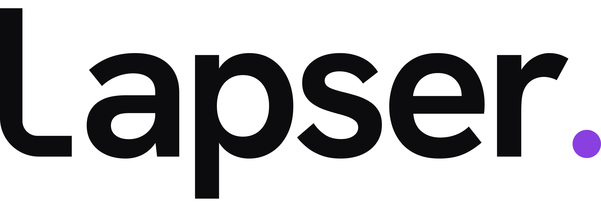

<picture>
  <source media="(prefers-color-scheme: dark)" srcset="./assets/lapser-wordmark-on-dark.svg">
  <source media="(prefers-color-scheme: light)" srcset="./assets/lapser-wordmark-on-light.svg">
  
</picture>

**Lapser. Beyond the race.**

Lapser brings grassroots motorsport together. We want every race to be easier to organise, more connected and more rewarding, before, during and beyond race day.

We are building with racers, for the people who make grassroots motorsport happen: drivers, teams, organisers and venues. Our direction is simple: less admin, stronger connections and more of the good stuff that makes racing worth it, whatever the result.

## What guides us

- **Community first.** Racing is better when teams, drivers and organisers can share the experience.
- **Free wherever sustainable.** Core team and driver tools should stay free or exceptionally affordable.
- **Business value, fairly funded.** Businesses may pay for useful services and measurable value.
- **Trust comes first.** We do not sell identifiable driver histories or contribution details.
- **Built with racers.** Community feedback should shape what Lapser becomes.

**Alpha: an early first look. Coming soon. Feedback welcome.** We will be clear about what is available and what is still to come.

[Visit lapser.io](https://lapser.io)

**Lapser Ltd** · Registered in England & Wales · Company no. 16819585
